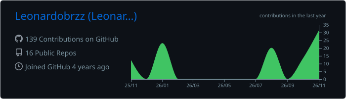
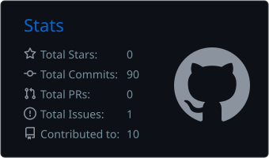
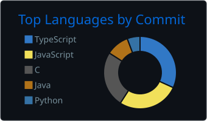
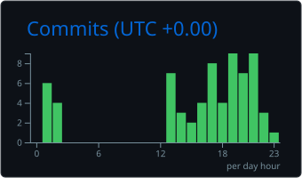

<!-- Cabeçalho animado -->


<p align="center">
  <a href="https://github.com/Leonardobrzz">
    
  </a>
</p>

<p align="center">
  <a href="https://portfolio-pessoal-leonardo-alves.vercel.app"></a>
  <a href="https://www.linkedin.com/in/leonardo-a-braz"></a>
  <a href="mailto:leonardoalves@alu.ufc.br"></a>
  
</p>

---

## 👨‍💻 Sobre mim


Sou **desenvolvedor full stack** de Fortaleza-CE, formado em **Engenharia da Computação da UFC**. Gosto de construir sistemas completos (banco, API, interface e deploy) e de
**medir** o que construo: desempenho, custo e qualidade.

- 💼 **Dev Full Stack na Arraia Midas**: criei e mantenho o **Sistema PAR**, app web em produção com Postgres (Neon) + Railway
- 🤖 Trabalhando com **IA aplicada**: agente que analisa a viabilidade de editais de licitação
- 🚌 Desenvolvendo o **MobDigno**, SaaS B2G de mobilidade urbana acessível para prefeituras (tema do meu TCC)
- 📊 Recentemente: benchmark de **busca vetorial no PostgreSQL** com projeto fatorial 2⁴ ([pgvector-bench](https://github.com/Leonardobrzz/pgvector-bench))
- 🔬 Antes: bolsista dev na **RAV Tecnologia** e pesquisa em **visão computacional para saúde** e QA no **LESC-UFC**
- 🧑‍🏫 Ex-monitor de **Eletrônica Digital**

<br clear="right"/>

---

## 🔭 Neste momento

```yaml
trabalhando_em:  Sistema PAR (Jota Barros Projetos) · agente de viabilidade de licitações
construindo:     MobDigno — painel para prefeituras com PostGIS, mapas de calor e multi-tenancy (RLS)
estudando:       RAG · bancos vetoriais · arquitetura de sistemas · cloud
último_projeto:  pgvector-bench — HNSW até 12× mais rápido que IVFFlat em 5,68 mi de consultas
aberto_a:        oportunidades em desenvolvimento full stack e IA aplicada
```

---

## 🚀 Projetos em destaque

<table>
  <tr>
    <td width="50%" valign="top">
      <h3>📊 <a href="https://github.com/Leonardobrzz/pgvector-bench">pgvector-bench</a></h3>
      Avaliação de desempenho da busca vetorial no PostgreSQL (etapa de recuperação de sistemas RAG) com fatorial 2⁴ e 5 réplicas: 80 rodadas, 5,68 milhões de consultas, artigo no formato SBC.<br/><br/>
      
      
      
      
    </td>
    <td width="50%" valign="top">
      <h3>🏗️ Sistema PAR</h3>
      Sistema web interno da Jota Barros Projetos, em produção. Migração de Supabase para Neon, otimização de cache e consumo de rede, e integração com um agente de IA para análise de editais.<br/><br/>
      
      
      
    </td>
  </tr>
  <tr>
    <td width="50%" valign="top">
      <h3>🚌 MobDigno</h3>
      SaaS B2G de mobilidade urbana acessível. Painel administrativo para prefeituras, mapas de calor geoespaciais com PostGIS e arquitetura multi-tenant com Row Level Security.<br/><br/>
      
      
      
      
    </td>
    <td width="50%" valign="top">
      <h3>📅 BizBooker Pro</h3>
      Sistema profissional de agendamentos, com autenticação, painel e API própria.<br/><br/>
      
      
      
      
    </td>
  </tr>
</table>

<details>
<summary><b>📁 Outros projetos</b></summary>
<br/>

| Projeto | Descrição | Stack |
|---|---|---|
| **My Rental Hub** | Plataforma de gerenciamento de aluguéis | React · Node.js · PostgreSQL |
| **Aura Weather** | App de previsão do tempo | React · Vite · Tailwind |
| **AquaGuard Mobile** | Monitoramento de qualidade da água | Flutter · Firebase |
| **Embarca Tech** | Monitoramento de nível d'água | Raspberry Pi Pico · C |
| **Cidade Inteligente** | Automação urbana | Arduino · C++ |
| **Imagens médicas** | Visão computacional para saúde | Python · TensorFlow · OpenCV |

</details>

---

## 🛠️ Tecnologias

<p align="center">
  <br/>
  
</p>

<details>
<summary><b>Ver por área</b></summary>
<br/>

| Área | Ferramentas |
|---|---|
| **Frontend & Mobile** | React, Next.js, TypeScript, Tailwind, shadcn/ui, Flutter |
| **Backend & Dados** | Node.js, Prisma, PostgreSQL, PostGIS, pgvector, Supabase, Neon, Firebase |
| **IA & Dados** | Python, RAG, embeddings, TensorFlow, OpenCV, pandas, NumPy |
| **Infra** | Docker, Railway, Vercel, GitHub Actions |
| **Embarcados** | C, C++, Arduino, Raspberry Pi Pico, STM32, KiCad |

</details>

---

## 📈 Estatísticas

<div align="center">
  
  
</div>
<div align="center">
  
  
</div>

<br/>

<p align="center">
  
</p>

<p align="center">
  
</p>

<!-- Animação da cobrinha (gerada pelo workflow .github/workflows/snake.yml) -->
<picture>
  <source media="(prefers-color-scheme: dark)" srcset="https://raw.githubusercontent.com/Leonardobrzz/Leonardobrzz/output/github-snake-dark.svg" />
  
</picture>

---

## 🎯 Metas 2026

- [x] Colocar um sistema em produção para uma empresa de verdade
- [x] Publicar um estudo de desempenho com metodologia de experimentos
- [ ] Concluir o TCC sobre o MobDigno
- [ ] Aprofundar em cloud (AWS) e arquitetura de sistemas distribuídos
- [ ] Contribuir com projetos open source e produzir conteúdo técnico


